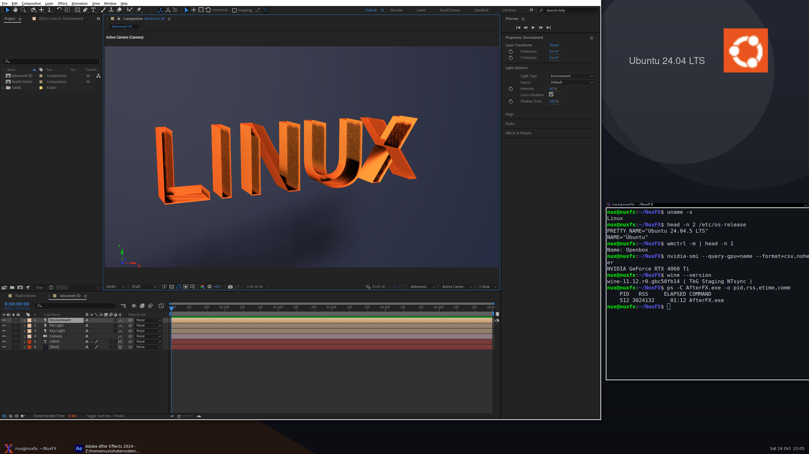
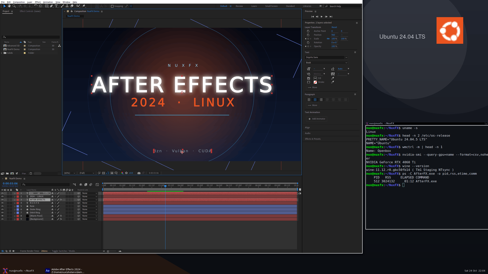
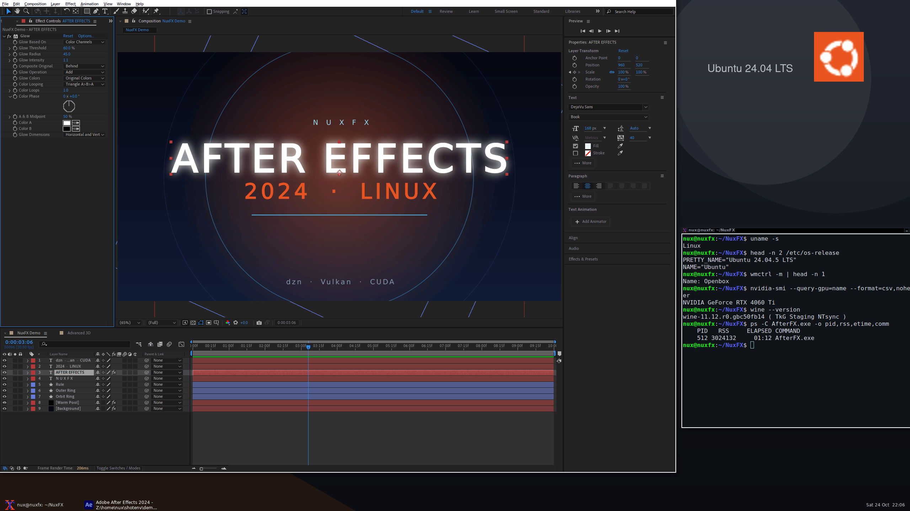
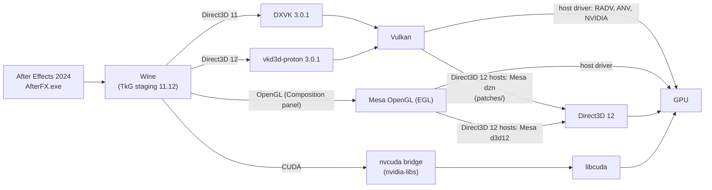

# NuxFX

> **Special thanks:** [@VulpesNoct1s](https://github.com/VulpesNoct1s) (Yakup ÜNAL).

**Adobe After Effects 2024 on Linux.** NuxFX is an installer, a set of scripts and tests, and a
Mesa patch series that run After Effects 2024 (24.6.2) on Wine with DXVK, vkd3d-proton and a CUDA
bridge. The Composition panel, CUDA acceleration and the Advanced 3D renderer work, with Adobe's
files unmodified.

NuxFX contains no Adobe software and no Wine runner, and it does not touch Adobe's licensing.
Bring your own licensed copy of After Effects 2024.

```sh
git clone https://github.com/chunsal/NuxFX.git
cd NuxFX
./install.sh
```



*After Effects 2024 (24.6.2) on an Ubuntu 24.04 desktop: an Advanced 3D comp with extruded text,
two point lights and an Environment light with shadows in the Composition panel. The terminal on
the right shows `uname -s`, `/etc/os-release`, the window manager, the GPU and the Wine build.*

## Contents

- [What works](#what-works)
- [Screenshots](#screenshots)
- [Install](#install)
- [Supported distributions](#supported-distributions)
- [Using NuxFX](#using-nuxfx)
- [How it works](#how-it-works)
- [Configuration](#configuration)
- [Tests](#tests)
- [Troubleshooting](#troubleshooting)
- [Repository layout](#repository-layout)
- [Known limitations](#known-limitations)
- [Documentation](#documentation)
- [License](#license)

## What works

| Feature | Status | Notes |
|---|---|---|
| Start and run After Effects 2024 (24.6.2) | Works | Adobe's files are used as they are |
| Composition panel | Works | OpenGL display, from the first start |
| CUDA | Works | After Effects uses CUDA acceleration; Direct3D interop is not implemented |
| Advanced 3D renderer (`ADBE Calder`) | Works | Cameras, lights, extruded 3D text, Environment-light shadows and IBL pass (`tests/run_ae_advanced3d_scene_test.sh`); frames from 480x270 to 1920x1080 render (`run_ae_advanced3d_size_test.sh`) and the Composition panel shows a 1080p scene (`run_ae_advanced3d_viewer_test.sh`, patch 21); imported 3D models were not tested |
| Shared Direct3D 11 textures and keyed mutexes | Works | Patch 21; before it, After Effects crashed when the viewer showed an Advanced 3D comp (`tests/run_d3d11_shared_texture_test.sh`) |
| Classic 3D renderer | Works | Panel and render queue |
| Direct3D 11 windows | Works | Patch 17 (`tests/run_dxgi_present_test.sh`) |
| Effects on the GPU | Works | 40 effects render in CUDA and software mode; 4 showed no visible change with the test parameter, mean difference at most 0.7/255 (`tests/run_ae_effects_test.sh`) |
| RAM preview (space) | Partly | The picture plays at real time, but the timeline playhead stays at the start; see [known limitations](#known-limitations) |
| Cinema 4D renderer (`ADBE Ernst`) | Does not work | After Effects' plugin scan does not load the plugin |

The match name `ADBE Advanced 3d` is the classic renderer. Advanced 3D is `ADBE Calder`.

## Screenshots

All pictures are captures of After Effects 2024 running under Wine on a Linux desktop (Openbox, a
panel and a wallpaper on a private X server); nothing of another desktop is in them. They are
2560x1440 PNG files in [docs/screenshots](docs/screenshots).

| | |
|---|---|
|  |  |
| A 1080p title comp with shape layers, text and a Glow effect. | The Effect Controls panel of the same comp: Glow and its parameters. |

## Install

You need a Linux (x86-64) user with `sudo`, an internet connection, about 10 GB of free disk space,
a current NVIDIA driver (CUDA and Advanced 3D need an NVIDIA GPU), and the `Support Files` folder
of an After Effects 2024 installation (`C:\Program Files\Adobe\Adobe After Effects 2024\Support
Files` on Windows; copy it to the Linux machine first if it is not mounted there).

```sh
git clone https://github.com/chunsal/NuxFX.git
cd NuxFX
./install.sh
```

The installer asks first, then runs without further input:

1. **After Effects folder.** It lists the installs it finds, or lets you type or browse for the
   `Support Files` folder.
2. **Plugins and extensions.** It shows where plugins (`.aex`) and CEP extensions live in the Wine
   prefix and offers to import them from a folder.
3. **Plan.** It shows every choice and asks once before it starts.

Then it installs the system packages (with `sudo`), Wine, the OpenGL and Vulkan pieces the GPU
route needs, the Wine prefix, DXVK, vkd3d-proton, the CUDA bridge, your After Effects files, your
plugins and a menu entry, and finishes with `scripts/doctor.sh`. Downloads are checked by SHA-256.
Finished parts are skipped when you run it again. On a fast machine and connection it takes
about 10 to 15 minutes.

Options: `./install.sh --help` (`--yes`, `--ae-dir`, `--plugins`, `--extensions`, `--home`,
`--no-packages`, `--no-cuda`, `--no-dzn`, `--force`, `--dry-run`).

The installer does not download Adobe software. The steps it performs are listed in
[docs/manual-installation.md](docs/manual-installation.md) for people who want to do them by hand.

**Update:** `git pull`, then `./install.sh` again. Only what changed is rebuilt.

**Uninstall:** `scripts/stop_ae.sh`, then delete `~/.local/share/aegnux`, `~/.config/aegnux` and
`~/.local/share/applications/nuxfx-after-effects.desktop`.

## Supported distributions

| Distribution | Status |
|---|---|
| Ubuntu 24.04 LTS | Verified |
| Debian 13 | Verified |
| Fedora 44 | Verified |
| Arch Linux | Verified |
| openSUSE Tumbleweed | Verified |
| Other releases and derivatives (Ubuntu 22.04 and 26.04, Debian 12, Linux Mint, Pop!_OS, Rocky, Alma, openSUSE Leap, Manjaro, EndeavourOS, ...) | Not verified; they use the same four package families (apt, dnf, pacman, zypper) |

**Verified** means: a fresh image of the distribution, `./install.sh --yes`, `scripts/doctor.sh`
with no failure, and these tests all passing: `tests/run_gl_window_test.sh`,
`tests/run_ae_viewer_test.sh`, `tests/run_ae_advanced3d_test.sh` (renderer `ADBE Calder`, CUDA
acceleration) and `tests/run_push_descriptor_test.sh`.

**What was run and what was not.** The five runs above used one NVIDIA GPU that the Linux system
reached through Direct3D 12 (WSL2 on Windows 11), so the GPU layer was Mesa's Dozen (dzn) Vulkan
driver with the patches in `patches/`. On a machine with a native GPU driver the same installer
and scripts take the other route: they detect it, skip the dzn and Mesa builds, and use the host's
Vulkan and OpenGL drivers and its `libcuda` (`AEGNUX_VULKAN=system`). That route is written, but
nobody has run it on bare metal yet. Everything above the GPU driver (packages, Wine, prefix,
After Effects setup, tests) is ordinary Linux userspace and is the same on both routes. Reports
from other hardware are welcome; please attach the output of `scripts/doctor.sh`.

## Using NuxFX

```sh
scripts/launch_ae.sh     # start After Effects (or use the "After Effects (NuxFX)" menu entry)
scripts/stop_ae.sh       # stop it and its Wine server
scripts/doctor.sh        # read-only check of the host, the prefix and After Effects
```

`launch_ae.sh` clears the previous-crash state, applies the preferences NuxFX needs
(`scripts/ae_prefs.sh`) and starts After Effects. `scripts/launch_ae.sh 150` stops it after 150
seconds. Plugins and extensions can be added later to the folders the installer printed.

### Preferences set by ae_prefs.sh

| Setting | Why | Opt out |
|---|---|---|
| `DS.DisableDirectXDisplay = true` (Debug Database) | With CUDA available, After Effects shows Composition panel frames through its DirectX display, which passes images between CUDA and Direct3D 12. The CUDA bridge cannot share those resources, so the panel stayed empty. | `AEGNUX_DIRECTX_DISPLAY=1` |
| `"Show Welcome Screen" = 00` (Prefs) | The HTML Home screen renders as an empty panel that covers the workspace. | `AEGNUX_HIDE_HOME_SCREEN=0` |

## How it works



- **Wine** (TkG staging 11.12, a prebuilt runner by Kron4ek, checked by SHA-256) runs
  `AfterFX.exe`. The Wine prefix gets DXVK 3.0.1 for Direct3D 11, vkd3d-proton 3.0.1 for
  Direct3D 12, nvidia-libs 1.0.2 (`nvcuda.dll`) for CUDA, the Visual C++ runtime and Adobe's own
  `d3dcompiler_47.dll`.
- **GPU route, host drivers.** On a Linux machine with a native driver, Vulkan, OpenGL and CUDA
  come from the host.
- **GPU route, Direct3D 12 hosts.** Where the GPU is reachable only through Direct3D 12,
  [Mesa's Dozen driver](https://docs.mesa3d.org/drivers/dozen.html) provides Vulkan. The 20
  patches in `patches/` apply to pristine Mesa 25.2.8 and make it good enough for DXVK,
  vkd3d-proton and After Effects. Wine's OpenGL (the Composition panel) uses Mesa's Direct3D 12
  OpenGL driver; `scripts/build_gl.sh` builds that driver and EGL from the same Mesa source into
  their own folder and the scripts put it first in `LD_LIBRARY_PATH`, so it does not depend on the
  Mesa of the distribution (Mesa 26 left the panel empty).
- **The scripts** keep the setup stable: they install the libraries Wine opens at run time, set
  the After Effects preferences, clear crash state, and check everything (`doctor.sh`).

## Configuration

Each setting comes from the environment. If it is not set there, it comes from
`~/.config/aegnux/aegnux.conf` (plain `KEY=value` lines; `AEGNUX_CONFIG` points elsewhere). If it
is not there either, the default in `scripts/common.sh` is used.

| Variable | Default | Meaning |
|---|---|---|
| `AEGNUX_HOME` | `~/.local/share/aegnux` | Data folder |
| `WINE_BIN_DIR` | `$AEGNUX_HOME/runner/bin` | Wine runner |
| `WINEPREFIX` | `$AEGNUX_HOME/wineprefix` | Wine prefix |
| `AE_DIR` | `$AEGNUX_HOME/AE` | Folder that contains `AfterFX.exe` |
| `AEGNUX_VULKAN` | `auto` | `dzn`, `system` or `auto` (dzn on Direct3D 12 hosts, the host's driver elsewhere) |
| `DZN_PREFIX` | `$AEGNUX_HOME/dzn` | dzn install, written by `build_dzn.sh` |
| `AEGNUX_GL_PREFIX` | `$AEGNUX_HOME/mesa-gl` | Install of `scripts/build_gl.sh` (Mesa's EGL and d3d12 OpenGL driver). Used first when it exists on a Direct3D 12 host |
| `AEGNUX_SYSTEM_GL` | `0` | `1` uses the distribution's OpenGL even when `AEGNUX_GL_PREFIX` exists |
| `AEGNUX_REP_MOVSB` | `0` | `1` keeps glibc's `memcpy` on `rep movsb`. By default, on a Direct3D 12 host, `aegnux_env` sets a glibc tunable that avoids it: with `rep movsb` RAM preview ran at a fifth of real time |
| `AEGNUX_DISABLE_CUDA` | `0` | `1` turns CUDA off for After Effects. It then renders in software and reports Advanced 3D as unsupported |
| `AEGNUX_DIRECTX_DISPLAY` | `0` | `1` keeps After Effects' DirectX display (the panel stays empty while CUDA is used) |
| `AEGNUX_HIDE_HOME_SCREEN` | `1` | `0` keeps After Effects' Home screen setting. On a first start `ae_prefs.sh` writes a preferences file with the Home screen off |
| `AEGNUX_COACHMARKS` | `1` | `0` switches off the first-start tips (the tests use it) |
| `AEGNUX_EXTRA_OVERRIDES` | empty | Extra `WINEDLLOVERRIDES` entries |
| `AEGNUX_WINEDEBUG` | errors only | `WINEDEBUG` for After Effects |
| `AEGNUX_APIVER_LAYER` | `0` | `1` enables the optional apiVersion layer (not needed with patch 04) |

The code and the configuration keep the `aegnux` name (`AEGNUX_*`, `~/.local/share/aegnux`).

## Tests

```sh
tests/run_gl_window_test.sh        # an OpenGL child window reaches the screen (no After Effects needed)
tests/run_ae_viewer_test.sh        # the Composition panel shows a rendered comp
tests/run_ae_advanced3d_test.sh    # Advanced 3D renders a tilted 3D solid; the project uses CUDA
tests/run_ae_advanced3d_scene_test.sh  # cameras, lights, shadows, Environment-light IBL, text and stress
tests/run_ae_advanced3d_size_test.sh   # Advanced 3D frames from 480x270 to 1920x1080
tests/run_ae_advanced3d_viewer_test.sh # a 1080p Advanced 3D scene in the Composition panel; Draft 3D clicked twice (patch 21)
tests/run_ae_ram_preview_test.sh   # RAM preview plays a 10 s comp at about real time
tests/run_ae_effects_test.sh       # 40 common effects render in CUDA and in software mode
tests/run_push_descriptor_test.sh  # dzn push descriptors reach a compute shader (patch 20)
tests/run_semaphore_share_test.sh  # two Vulkan devices share a timeline semaphore (patch 21)
tests/run_d3d11_shared_texture_test.sh  # two Direct3D 11 devices share a texture, with and without a keyed mutex (patch 21)
tests/run_dxgi_present_test.sh     # a Direct3D 11 swapchain shows its backbuffer (patch 17)
scripts/gpu_sniffer_test.sh        # dzn entrypoint audit, then After Effects' GPUSniffer test
```

- The OpenGL window test and the After Effects tests run on a private Xvfb display, so nothing
  appears on your desktop and no input can interfere. (`run_dxgi_present_test.sh` and
  `gpu_sniffer_test.sh` open their windows on your current display.) The tests need `xdotool`,
  `xwininfo` (`x11-utils`), `xvfb`, `python3` and `gcc` with X11 headers; the Windows test
  programs need `x86_64-w64-mingw32-gcc`. `scripts/doctor.sh` prints the install command for
  your distribution.
- `run_gl_window_test.sh` opens a Windows window with an OpenGL child window (how After Effects
  draws the Composition panel) and looks for its cyan fill in a screenshot. It fails and names the
  missing library when Wine cannot show the child window. About 15 seconds.
- `run_ae_viewer_test.sh` starts After Effects with a temporary startup script that creates a comp
  with a red solid and an Invert effect, and passes if the panel shows cyan.
- `run_ae_advanced3d_test.sh` selects the Advanced 3D renderer for a comp with a tilted red 3D
  solid, saves frame 0 as a PNG and passes if the renderer stays `ADBE Calder`, the project uses
  CUDA and the PNG shows red and no magenta. The result travels in the name of a comp in a project
  the script saves, because After Effects scripts may not write files by default.
- `run_ae_advanced3d_scene_test.sh` starts After Effects once and builds six small comps: a moving
  camera, a point light, an Environment light that casts shadows, extruded 3D text against Classic
  3D, an Environment light that lights a wall and text, and a 30-solid stress scene. Each frame
  must be valid (no magenta, not one colour) and each feature must change the picture in the
  expected direction. `AEGNUX_A3D_SCENES=cam,light,...` runs a subset. About 4 minutes.
- `run_ae_advanced3d_size_test.sh` builds one scene (extruded text, a wall, a camera, a point light;
  and a variant with an Environment light that casts shadows) at 480x270, 960x540, 1280x720 and
  1920x1080, renders frame 0 of each to a PNG and checks that the picture is valid and shows the
  text. About 2 minutes. `AEGNUX_A3D_SIZES=1920x1080` runs one size.
- `run_ae_advanced3d_viewer_test.sh` shows a 1920x1080 Advanced 3D comp in the Composition panel
  and clicks the Draft 3D button of the viewer twice (a script cannot take the path that the button
  takes). It passes when After Effects is still running, no error box appeared and the orange 3D
  text is on screen before and after. Before patch 21 the first click ended with "Crash in
  progress". About 4 minutes.
- `run_semaphore_share_test.sh` (no Wine, no After Effects) lets two Vulkan devices share a
  timeline semaphore as an opaque fd: CPU signals, queue signals and queue waits must cross, and
  an imported semaphore must be exportable again. It skips when the device has no external
  semaphore fd support. `run_d3d11_shared_texture_test.sh` does the same one level up: two
  Direct3D 11 devices share a texture with and without a keyed mutex, and the second device must
  read the pixel the first one wrote.
- `run_ae_ram_preview_test.sh` builds a 10 s comp with a moving, rotating layer, presses space in
  the Composition panel and follows the picture in screenshots (the position of the layer is the
  comp time on screen). It prints the playback speed and passes at 0.8 times real time or more.
  The playhead of the timeline does not move during a preview (see the limitations). About 3 minutes.
- `run_ae_effects_test.sh` applies 40 common effects (blur, glow, colour, noise, distort, stylize
  and transform effects), each with one non-default parameter, renders frame 0 of each in CUDA
  mode and again in software mode, and compares both with a comp without the effect. It passes
  when every applied effect renders in both modes; the table shows which effects change the
  picture and how far the two modes differ. About 8 minutes.
- `run_push_descriptor_test.sh` needs the Vulkan headers and loader (`libvulkan-dev`),
  `glslangValidator` and the dzn build. `gpu_sniffer_test.sh` needs the dzn build and the After
  Effects files.
- The After Effects tests stop any After Effects of the prefix that is running.

## Troubleshooting

Start with `scripts/doctor.sh`. It prints what is missing and the install command for your
distribution.

| Symptom | Cause and fix |
|---|---|
| The Composition panel is black although the timeline and the panels work | Wine opens `libXcomposite.so.1` at run time; without it OpenGL child windows stay black and nothing complains. Install it (`doctor.sh` prints the command). `tests/run_gl_window_test.sh` shows the effect |
| The Composition panel is empty on Arch Linux, Fedora 44 or Tumbleweed (Direct3D 12 route) | The distribution's Mesa 26 does not work with After Effects' viewer. `scripts/build_gl.sh` builds the tested Mesa 25.2.8 OpenGL stack (the installer does it); `AEGNUX_SYSTEM_GL` must not be `1` |
| "Advanced 3D is not supported by the current hardware" | After Effects needs CUDA and its accelerated display. Check that `AEGNUX_DISABLE_CUDA` is not set and that `doctor.sh` reports CUDA. Do not switch off After Effects' accelerated display or hide OpenGL from Wine |
| Advanced 3D frames are magenta after an earlier failed render | A stale disk cache serves the old frame. Empty it once (Preferences > Media & Disk Cache > Empty Disk Cache) |
| "Crash in progress. Last logged message was: <3D.Tiling> ..." when an Advanced 3D comp is in the Composition panel (Direct3D 12 route) | The dzn build lacks patch 21 (shared timeline semaphores); DXVK then throws out of `OpenSharedResource1`. Run `scripts/build_dzn.sh` again; `doctor.sh` warns about an old build. `tests/run_d3d11_shared_texture_test.sh` shows it without After Effects |
| "System Compatibility Report: Unsupported Video Driver" on every start (Direct3D 12 route) | Wine reported a second GPU. The scripts set `MESA_LOADER_DRIVER_OVERRIDE=d3d12`, which prevents it. If it shows anyway, click "Continue with known issues" |
| RAM preview plays at a fifth of real time (about 7 frames a second) on the Direct3D 12 route | glibc's `memcpy` uses `rep movsb`, which is very slow on the shared buffers of Mesa's d3d12 driver. The scripts set `GLIBC_TUNABLES=glibc.cpu.x86_rep_movsb_threshold=0x40000000`; `AEGNUX_REP_MOVSB` must not be `1`, and After Effects must be started through `scripts/launch_ae.sh` (or `aegnux_env`) |
| The first start shows nothing but an empty Home screen | `ae_prefs.sh` switches the Home screen off; run `scripts/launch_ae.sh` instead of `AfterFX.exe` directly |

More causes, evidence and the history of each fix: [docs/known-issues.md](docs/known-issues.md).

## Repository layout

```
install.sh        one-command installer (install.cmd starts it from Windows)
patches/          21 patches (git format-patch) against pristine Mesa 25.2.8
scripts/          build_dzn.sh          build and install dzn (Direct3D 12 hosts)
                  build_gl.sh           build and install Mesa's EGL and d3d12 OpenGL driver
                  launch_ae.sh          start After Effects (applies ae_prefs.sh and clear_crash_state.sh)
                  stop_ae.sh            stop After Effects and its wineserver
                  doctor.sh             read-only check of host, prefix, After Effects and tools
                  ae_prefs.sh           the After Effects preferences this setup needs
                  clear_crash_state.sh  clears After Effects' previous-crash state
                  common.sh             shared settings, platform detection, package hints
                  gpu_sniffer_test.sh   entrypoint audit, then GPUSniffer
                  dzn_audit.c, gen_cmds.py   entrypoint audit of dzn
                  apiver_layer/         optional Vulkan layer (apiVersion), off by default
                  tools/xcap.c          X11 screen capture for the tests
tests/            run_*.sh and the C and GLSL sources they build
docs/             manual-installation.md  the installer's steps, by hand
                  technical-note.md       findings and evidence, section by section
                  known-issues.md         fixed and open issues, stubs, limitations
                  screenshots/            captures of After Effects on a Linux desktop
```

## Known limitations

- **RAM preview** (space) plays at real time in the Composition panel, but the playhead of the
  timeline stays at the start while it plays, and `comp.time` does too. The cause is not known;
  `docs/known-issues.md` has what was found.
- **Cinema 4D renderer** (`ADBE Ernst`): After Effects asks for Cinema 4D 2024 (it looks for
  `cineware.dll` in `C:\Program Files\Maxon Cinema 4D 2024`) and shows a warning when the renderer
  is selected. The prefix has no such folder, so the renderer is not usable; it was not tested
  with Cinema 4D installed.
- **CUDA** works for After Effects' acceleration and for Advanced 3D, but sharing images between
  CUDA and Direct3D is not implemented (`cuGraphicsD3D11RegisterResource` returns
  `CUDA_ERROR_NOT_SUPPORTED`).
- **Advanced 3D** was tested with six scenes (camera, point light, Environment-light shadow,
  extruded text, Environment-light IBL and a 30-solid stress scene), at sizes up to 1920x1080 and in
  the Composition panel at 1080p. Imported 3D models (GLTF/GLB/OBJ/FBX) were not tested. In AE 24.6
  only an Environment light casts shadows; point and spot lights illuminate without shadows. The
  old Layer > Environment Layer switch belongs to the Cinema 4D renderer and does not affect
  Advanced 3D. On the `Casts Shadows` menu of a layer, 2 is "Only" (the layer is not drawn).
- **Shared timeline semaphores** (patch 21) are an emulation on top of a memfd, because WSL's
  Direct3D 12 cannot open a shared fence. A queue wait for a value that another device signals
  later blocks the submitting thread, and a semaphore cannot be shared with another process.
- **Effects:** 40 common effects were applied with one non-default parameter each and rendered
  without error in CUDA mode and in software mode; the two modes differ by less than 0.7 of 255
  on average (`tests/run_ae_effects_test.sh`). Four of them (Curves, Polar Coordinates, Stroke,
  Vibrance) did not change the test picture with the parameter used, so they are untested in
  effect. Large projects, footage, text and shape layers, and third-party plug-ins were not
  tested.
- **Not verified:** bare-metal Linux with a native GPU driver, AMD and Intel GPUs, After Effects
  versions other than 24.6.2, and distributions not listed above.
- **dzn** is not a conformant Vulkan implementation. `VK_EXT_transform_feedback` is a no-op stub,
  there are no sparse resources, and patch 15 advertises 24 features and extensions without
  one-by-one tests (the list is in `docs/known-issues.md`).

## Documentation

- [docs/manual-installation.md](docs/manual-installation.md): what the installer does, step by step.
- [docs/known-issues.md](docs/known-issues.md): fixed issues with their causes, open issues, stubs
  and limitations.
- [docs/technical-note.md](docs/technical-note.md): how each problem was narrowed down, with the
  evidence.
- [CONTRIBUTING.md](CONTRIBUTING.md): patches, scripts, tests and bug reports.

NuxFX builds on [Wine](https://www.winehq.org/) (TkG builds by
[Kron4ek](https://github.com/Kron4ek/Wine-Builds)), [DXVK](https://github.com/doitsujin/dxvk),
[vkd3d-proton](https://github.com/HansKristian-Work/vkd3d-proton),
[nvidia-libs](https://github.com/SveSop/nvidia-libs) and [Mesa](https://www.mesa3d.org/).

## License

NuxFX is free software under the GNU General Public License, version 3 or later
(GPL-3.0-or-later). See [LICENSE](LICENSE). Any distributed modified version must also be
released as free software under the same license.

- Third-party notices: [NOTICE](NOTICE). Mesa and its dzn driver are MIT-licensed, and the MIT
  notice is reproduced there.
- Contributions: [CONTRIBUTING.md](CONTRIBUTING.md).

Adobe and After Effects are trademarks of Adobe. NuxFX is not affiliated with Adobe. Running
After Effects requires your own license from Adobe.
