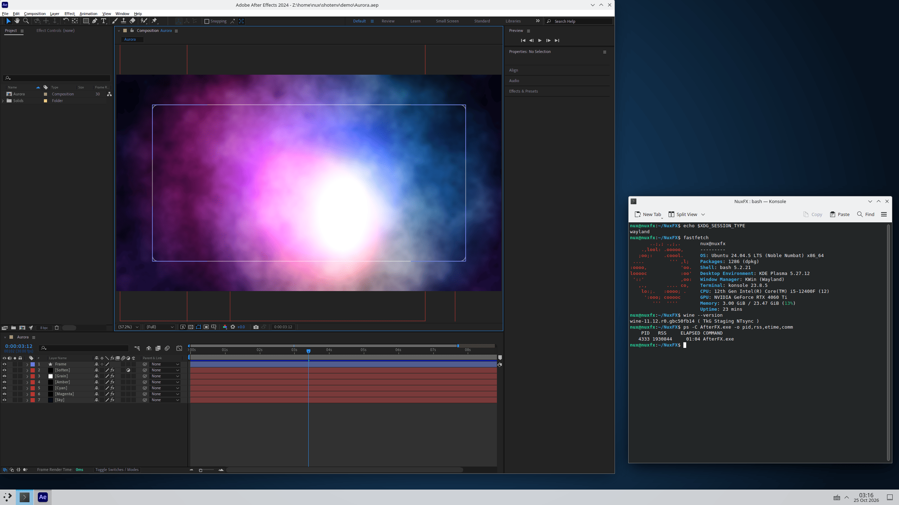

# NuxFX: Adobe After Effects on Linux

[](https://github.com/chunsal/NuxFX/releases/latest)
[](LICENSE)

-9999FF)


**NuxFX runs Adobe After Effects 2024 (24.6.2) on Linux**, on X11 and Wayland. It sets up Wine,
DXVK, vkd3d-proton and a CUDA bridge for you. The Composition panel, CUDA acceleration and the
Advanced 3D renderer work, and Adobe's files stay unmodified. One command installs it on Ubuntu,
Debian, Fedora, Arch Linux and openSUSE.

NuxFX is based on [AEGNUX](https://github.com/relativemodder/aegnux), which is inspired by
[AeNux](https://github.com/cutefishaep/AeNux). It contains no Adobe software and does not touch
Adobe's licensing: bring your own licensed copy of After Effects 2024.

> **Special thanks:** [@VulpesNoct1s](https://github.com/VulpesNoct1s) (Yakup ÜNAL).


## Quick start

```sh
git clone https://github.com/chunsal/NuxFX.git
cd NuxFX
./install.sh            # asks a few questions, then installs everything (10 to 15 minutes)
scripts/launch_ae.sh    # or start "After Effects (NuxFX)" from your application menu
```

You need:

- x86-64 Linux with `sudo`, about 10 GB of free disk space and internet access
- a current NVIDIA driver (CUDA and Advanced 3D need an NVIDIA GPU)
- the `Support Files` folder of your own After Effects 2024 installation (on Windows:
  `C:\Program Files\Adobe\Adobe After Effects 2024\Support Files`)

The installer shows its plan and asks once. Downloads are checked by SHA-256, and finished parts are
skipped when you run it again. Options: `./install.sh --help`. Update: `git pull`, then
`./install.sh`. Uninstall: `scripts/stop_ae.sh`, then delete `~/.local/share/aegnux`,
`~/.config/aegnux` and the menu entry. The same steps by hand:
[docs/manual-installation.md](docs/manual-installation.md).

## What works

| Feature | Status |
|---|---|
| Composition panel and CUDA acceleration | Works |
| Advanced 3D renderer: cameras, lights, shadows, extruded text, up to 1920x1080 | Works |
| Classic 3D renderer and Direct3D 11 windows | Works |
| 40 common effects, rendered with CUDA and in software | Work |
| X11 and Wayland sessions | Work (Wayland through XWayland; tested on KDE Plasma's KWin and on sway) |
| RAM preview | Works: real-time playback with sound, and as in After Effects itself the blue playhead stays put while a red preview-time needle follows the picture and the playhead jumps to the stop frame |
| Cinema 4D renderer | Does not work |

Verified on Ubuntu 24.04, Debian 13, Fedora 44, Arch Linux and openSUSE Tumbleweed, with Wine TkG
staging 11.12, DXVK 3.0.1, vkd3d-proton 3.0.1 and Mesa 25.2.8. What was tested, and how:
[docs/tests.md](docs/tests.md).

## Screenshots

After Effects 2024 under Wine on an X11 desktop (Openbox on a private X server) and in a KDE Plasma
Wayland session. The Advanced 3D screenshot is at the top.


*A 1080p title composition with shape layers, text and a Glow effect (Openbox, X11).*



*KDE Plasma 5.27 on Wayland (KWin, XWayland): an "Aurora" composition made of gradient ramps, fractal
noise and a blur. Konsole shows `echo $XDG_SESSION_TYPE` (wayland) and fastfetch.*

## FAQ

### Does Adobe After Effects run on Linux?

Yes, with NuxFX. It runs After Effects 2024 (24.6.2) through Wine. The Composition panel, CUDA
acceleration, the Advanced 3D renderer, RAM preview and 40 tested effects work. The Cinema 4D
renderer does not.

### How do I install After Effects on Linux?

Clone this repository and run `./install.sh` (see [Quick start](#quick-start)). It installs the system
packages, Wine, DXVK, vkd3d-proton, the CUDA bridge and your After Effects files, and ends with
`scripts/doctor.sh`. You provide the files of your own licensed After Effects 2024.

### Does NuxFX include After Effects or a license?

No. NuxFX contains no Adobe software and does not change Adobe's licensing or activation. You need
your own licensed copy of After Effects 2024. NuxFX itself is free software (GPL-3.0-or-later).

### Does it work on Wayland?

Yes. After Effects runs through Wine's X11 driver, which is XWayland on a Wayland desktop (GNOME,
KDE Plasma, sway, Hyprland), so there is nothing to configure. It was tested on KDE Plasma's KWin
and on sway (`tests/run_ae_wayland_test.sh`); GNOME was not tested. Wine's own Wayland driver is not
recommended. [Details](docs/wayland.md).

### Which GPU do I need?

An NVIDIA GPU with a current driver: After Effects uses CUDA, and the Advanced 3D renderer needs it.
AMD and Intel GPUs were not tested.

### Which Linux distributions are supported?

Ubuntu 24.04, Debian 13, Fedora 44, Arch Linux and openSUSE Tumbleweed are verified: a fresh image,
`./install.sh --yes`, a clean `scripts/doctor.sh` and four tests passing. Other releases and
derivatives (Linux Mint, Pop!_OS, Manjaro, Rocky, Alma, ...) use the same four package families (apt,
dnf, pacman, zypper) but were not verified.

### Does it run on a PC with a native GPU driver?

The five verification runs used one NVIDIA GPU that the system reaches through Direct3D 12, with
Mesa's Dozen (dzn) Vulkan driver and the patches in [`patches/`](patches). On a machine with a native
driver the installer takes another route: it skips the dzn and Mesa builds and uses the host's Vulkan
and OpenGL drivers and `libcuda`. That route is implemented but has not been run on bare hardware
yet. Reports are welcome; attach the output of `scripts/doctor.sh`.

### Which After Effects versions work?

NuxFX targets After Effects 2024 (24.6.2). Other versions were not tested.

### How is NuxFX related to AEGNUX?

NuxFX is based on AEGNUX and keeps its folder layout (`~/.local/share/aegnux`) and `aegnux` naming.
This repository contains an installer for five distributions, a Mesa patch series for GPU
acceleration, X11 and Wayland handling, a health check (`scripts/doctor.sh`) and automated tests.

### After Effects crashes when memory use is high. What can I do?

Check `vm.max_map_count`. Some distributions ship the old default of 65530, a likely cause.
`scripts/doctor.sh` warns below 1048576 and the installer raises it. A crash with nearly full memory
was not reproduced: a 4K, 120 s comp previewed until the RAM cache was full (9.7 GB on a 24 GB
machine) played at real time and After Effects stayed up (`tests/run_ae_ram_preview_heavy_test.sh`).
More: [docs/troubleshooting.md](docs/troubleshooting.md).

### RAM preview stops slowly and does not start a second time. Why?

It happened on the Direct3D 12 route, where the sound server of the display stack suspends its output
after five idle seconds and then does not resume the audio stream that After Effects opened at its
start: the audio thread hangs, a stopped preview takes a second longer and the next preview does not
start. `scripts/launch_ae.sh` fixes it by playing a silent stream for as long as After Effects runs
(`scripts/sound_keepalive.sh`, played by `pacat` or by `python3`); sound and RAM preview then both
work. Start After Effects with `launch_ae.sh`, not with `wine AfterFX.exe`. `scripts/doctor.sh`
checks the audio setup, and `tests/run_pulse_resume_test.sh` shows the server's behavior without
Wine. Other sound servers are left as they are. The red needle that runs along the
timeline during a preview is After Effects' preview position; the blue playhead moves to the stop
frame when you stop. [Details](docs/known-issues.md).

### What does not work yet?

The Cinema 4D renderer (it needs Maxon's `cineware.dll`), sharing images between CUDA and
Direct3D, and imported 3D models (not tested). AMD and Intel GPUs and bare hardware were not tested.
The full list: [docs/known-issues.md](docs/known-issues.md).

## Documentation

- [How it works](docs/how-it-works.md): Wine, DXVK, vkd3d-proton, CUDA, Mesa dzn and the two GPU routes
- [Configuration](docs/configuration.md): every `AEGNUX_*` setting
- [Troubleshooting](docs/troubleshooting.md): symptoms, causes and fixes
- [After Effects on Wayland](docs/wayland.md)
- [Tests](docs/tests.md), [known issues](docs/known-issues.md), [technical notes](docs/technical-note.md)
- [Contributing](CONTRIBUTING.md): patches, scripts, tests, bug reports, repository layout

## Credits and license

NuxFX is based on [AEGNUX](https://github.com/relativemodder/aegnux) by relativemodder (GPL-3.0),
which is inspired by [AeNux](https://github.com/cutefishaep/AeNux) by cutefish. It builds on
[Wine](https://www.winehq.org/) (TkG builds by [Kron4ek](https://github.com/Kron4ek/Wine-Builds)),
[DXVK](https://github.com/doitsujin/dxvk),
[vkd3d-proton](https://github.com/HansKristian-Work/vkd3d-proton),
[nvidia-libs](https://github.com/SveSop/nvidia-libs) and [Mesa](https://www.mesa3d.org/).

NuxFX is free software under the GNU General Public License, version 3 or later
(GPL-3.0-or-later): see [LICENSE](LICENSE) and [NOTICE](NOTICE) (Mesa and its dzn driver are
MIT-licensed). Adobe and After Effects are trademarks of Adobe. NuxFX is not affiliated with Adobe.
Running After Effects requires your own license from Adobe.
