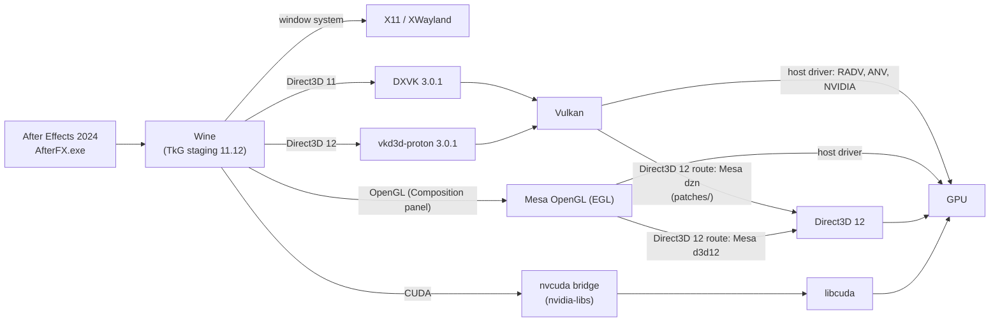

# NuxFX: Adobe After Effects on Linux

> **Special thanks:** [@VulpesNoct1s](https://github.com/VulpesNoct1s) (Yakup ÜNAL).

[](LICENSE)

-9999FF)


**Run Adobe After Effects 2024 on Linux, on X11 and Wayland.** NuxFX installs and starts After
Effects 2024 (24.6.2) under Wine with DXVK, vkd3d-proton and a CUDA bridge. The Composition panel,
CUDA acceleration and the Advanced 3D renderer work, and Adobe's files stay unmodified.

NuxFX is **based on [AEGNUX](https://github.com/relativemodder/aegnux)** (GPL-3.0), a convenient way
to install After Effects on Linux with Wine, which is itself inspired by
[AeNux](https://github.com/cutefishaep/AeNux) by cutefish. NuxFX keeps AEGNUX's folder layout
(`~/.local/share/aegnux`) and its `aegnux` naming (`AEGNUX_*` settings). This repository contains an
installer for five distributions, a Mesa patch series for GPU acceleration, X11 and Wayland
handling, a health check (`scripts/doctor.sh`) and automated tests.

NuxFX contains no Adobe software and no Wine runner, and it does not touch Adobe's licensing. Bring
your own licensed copy of After Effects 2024.


*After Effects 2024 (24.6.2) on an Ubuntu 24.04 desktop: an Advanced 3D comp with extruded text,
two point lights and an Environment light with shadows in the Composition panel. The terminal on
the right shows `uname -s`, `fastfetch`, the Wine build and the After Effects process.*

## At a glance

| | |
|---|---|
| **What it is** | An installer, scripts, tests and a Mesa patch series that run After Effects 2024 on Linux through Wine |
| **Based on** | [AEGNUX](https://github.com/relativemodder/aegnux) |
| **What works** | Composition panel, CUDA, Advanced 3D (cameras, lights, shadows, extruded text), 40 tested effects |
| **Display** | X11, and Wayland through XWayland (a Wayland desktop needs no extra step) |
| **GPU** | NVIDIA with a current driver; CUDA is needed for Advanced 3D |
| **Distributions** | Ubuntu 24.04, Debian 13, Fedora 44, Arch Linux, openSUSE Tumbleweed (verified) |
| **You provide** | The `Support Files` folder of your own After Effects 2024 installation |
| **License** | GPL-3.0-or-later |

## Quick start

```sh
git clone https://github.com/chunsal/NuxFX.git
cd NuxFX
./install.sh            # asks a few questions, then installs everything (about 10 to 15 minutes)
scripts/launch_ae.sh    # or use the "After Effects (NuxFX)" entry of your application menu
```

You need a Linux (x86-64) user with `sudo`, an internet connection, about 10 GB of free disk space,
a current NVIDIA driver, and the `Support Files` folder of an After Effects 2024 installation
(on Windows: `C:\Program Files\Adobe\Adobe After Effects 2024\Support Files`; copy it to the Linux
machine first if it is not mounted there). Details: [Install](#install).

## Contents

- [What works](#what-works)
- [Screenshots](#screenshots)
- [Install](#install)
- [Supported distributions](#supported-distributions)
- [X11 and Wayland](#x11-and-wayland)
- [Using NuxFX](#using-nuxfx)
- [Troubleshooting](#troubleshooting)
- [How it works](#how-it-works)
- [Configuration](#configuration)
- [Tests](#tests)
- [Repository layout](#repository-layout)
- [Known limitations](#known-limitations)
- [Credits and documentation](#credits-and-documentation)
- [License](#license)

## What works

| Feature | Status | Notes |
|---|---|---|
| Start and run After Effects 2024 (24.6.2) | Works | Adobe's files are used as they are |
| Composition panel | Works | OpenGL display, from the first start |
| CUDA | Works | After Effects uses CUDA acceleration; Direct3D interop is not implemented |
| Advanced 3D renderer (`ADBE Calder`) | Works | Cameras, lights, extruded 3D text, Environment-light shadows and IBL pass (`tests/run_ae_advanced3d_scene_test.sh`); frames from 480x270 to 1920x1080 render (`run_ae_advanced3d_size_test.sh`) and the Composition panel shows a 1080p scene (`run_ae_advanced3d_viewer_test.sh`, patch 21); imported 3D models were not tested |
| Shared Direct3D 11 textures and keyed mutexes | Works | Patch 21; before it, After Effects crashed when the viewer showed an Advanced 3D comp (`tests/run_d3d11_shared_texture_test.sh`) |
| Classic 3D renderer | Works | Panel and render queue |
| Direct3D 11 windows | Works | Patch 17 (`tests/run_dxgi_present_test.sh`) |
| Effects on the GPU | Works | 40 effects render in CUDA and software mode; 4 showed no visible change with the test parameter, mean difference at most 0.7/255 (`tests/run_ae_effects_test.sh`) |
| X11 and Wayland sessions | Works | Wine's X11 driver, through XWayland on Wayland (`tests/run_ae_wayland_test.sh`); see [X11 and Wayland](#x11-and-wayland) |
| RAM preview (space) | Partly | The picture plays at real time, but the timeline playhead stays at the start; see [known limitations](#known-limitations) |
| Cinema 4D renderer (`ADBE Ernst`) | Does not work | After Effects' plugin scan does not load the plugin |

The match name `ADBE Advanced 3d` is the classic renderer. Advanced 3D is `ADBE Calder`.

## Screenshots

All pictures are captures of After Effects 2024 running under Wine on a Linux desktop (Openbox, a
panel and a wallpaper on a private X server); nothing of another desktop is in them. They are
2560x1440 PNG files in [docs/screenshots](docs/screenshots).

| | |
|---|---|
|  |  |
| A 1080p title comp with shape layers, text and a Glow effect. | The Effect Controls panel of the same comp: Glow and its parameters. |

## Install

Requirements: a Linux (x86-64) user with `sudo`, an internet connection, about 10 GB of free disk
space, a current NVIDIA driver (CUDA and Advanced 3D need an NVIDIA GPU), and the `Support Files`
folder of an After Effects 2024 installation.

```sh
git clone https://github.com/chunsal/NuxFX.git
cd NuxFX
./install.sh
```

The installer asks first, then runs without further input:

1. **After Effects folder.** It lists the installs it finds, or lets you type or browse for the
   `Support Files` folder.
2. **Plugins and extensions.** It shows where plugins (`.aex`) and CEP extensions live in the Wine
   prefix and offers to import them from a folder.
3. **Plan.** It shows every choice and asks once before it starts.

Then it installs the system packages (with `sudo`), raises `vm.max_map_count` to 1048576 when it is
lower (the plan says so first; see [Troubleshooting](#troubleshooting)), and sets up Wine, the OpenGL
and Vulkan pieces the GPU route needs, the Wine prefix, DXVK, vkd3d-proton, the CUDA bridge, your
After Effects files, your plugins and a menu entry. It finishes with `scripts/doctor.sh`. Downloads
are checked by SHA-256. Finished parts are skipped when you run it again. On a fast machine and
connection it takes about 10 to 15 minutes.

Options: `./install.sh --help` (`--yes`, `--ae-dir`, `--plugins`, `--extensions`, `--home`,
`--no-packages`, `--no-cuda`, `--no-dzn`, `--force`, `--dry-run`).

The installer does not download Adobe software. The steps it performs are listed in
[docs/manual-installation.md](docs/manual-installation.md) for people who want to do them by hand.

**Update:** `git pull`, then `./install.sh` again. Only what changed is rebuilt.

**Uninstall:** `scripts/stop_ae.sh`, then delete `~/.local/share/aegnux`, `~/.config/aegnux` and
`~/.local/share/applications/nuxfx-after-effects.desktop`.

## Supported distributions

| Distribution | Status |
|---|---|
| Ubuntu 24.04 LTS | Verified |
| Debian 13 | Verified |
| Fedora 44 | Verified |
| Arch Linux | Verified |
| openSUSE Tumbleweed | Verified |
| Other releases and derivatives (Ubuntu 22.04 and 26.04, Debian 12, Linux Mint, Pop!_OS, Rocky, Alma, openSUSE Leap, Manjaro, EndeavourOS, ...) | Not verified; they use the same four package families (apt, dnf, pacman, zypper) |

**Verified** means: a fresh image of the distribution, `./install.sh --yes`, `scripts/doctor.sh`
with no failure, and these tests all passing: `tests/run_gl_window_test.sh`,
`tests/run_ae_viewer_test.sh`, `tests/run_ae_advanced3d_test.sh` (renderer `ADBE Calder`, CUDA
acceleration) and `tests/run_push_descriptor_test.sh`.

**Two GPU routes.** NuxFX picks the route when it installs (`scripts/doctor.sh` shows which):

- **Host-driver route.** The system has a native GPU driver. The installer skips the dzn and Mesa
  builds and uses the host's own Vulkan and OpenGL drivers and its `libcuda`
  (`AEGNUX_VULKAN=system`).
- **Direct3D 12 route.** The GPU is reachable only through Direct3D 12 (`/dev/dxg`). Mesa's Dozen
  (dzn) Vulkan driver, built with the patches in `patches/`, provides Vulkan.

**What was run and what was not.** The five verification runs above took the Direct3D 12 route with
one NVIDIA GPU. The host-driver route is written, but it has not been run on bare hardware yet.
Everything above the GPU driver (packages, Wine, prefix, After Effects setup, tests) is ordinary
Linux userspace and is the same on both routes. Reports from other hardware are welcome; please
attach the output of `scripts/doctor.sh`.

## X11 and Wayland

NuxFX works in X11 sessions and in Wayland sessions (GNOME, KDE Plasma, sway, Hyprland and others).
After Effects runs through Wine's X11 driver, the setup everything here was verified with. On a
Wayland desktop that driver talks to **XWayland**, which these compositors start by default, so
there is nothing to configure.

- `scripts/launch_ae.sh` looks at the session. When `DISPLAY` exists (X11, or XWayland in a Wayland
  session), Wine is told to use X11 and `WAYLAND_DISPLAY` is hidden from it. A Wine that sees both
  would pick its own Wayland driver, which was never tested with After Effects.
- When only `WAYLAND_DISPLAY` exists (a Wayland session without XWayland), Wine's Wayland driver is
  used and `scripts/doctor.sh` warns about it. Install `xwayland` (the package name is printed) to
  get the tested setup.
- `AEGNUX_WAYLAND=0` always uses X11, and `AEGNUX_WAYLAND=1` always uses Wine's Wayland driver.
- `tests/run_ae_wayland_test.sh` starts After Effects inside a private, headless sway compositor
  (both variables set, XWayland on) and checks that the Composition panel shows the rendered comp.
  It passes: Wine loads its X11 driver and the panel shows the comp.

**Wine's own Wayland driver is not recommended.** It needs libwayland-client 1.23 or newer. With
1.22 (Ubuntu 24.04) it cannot load and no window appears; `launch_ae.sh` and `doctor.sh` detect that
and say so. With a new enough libwayland, After Effects started in the test compositor and drew its
workspace, but at once reported "Advanced 3D is not supported by the current hardware", which the X11
route does not. XWayland is the setup to use until that is understood.

## Using NuxFX

```sh
scripts/launch_ae.sh     # start After Effects (or use the "After Effects (NuxFX)" menu entry)
scripts/stop_ae.sh       # stop it and its Wine server
scripts/doctor.sh        # read-only check of the host, the prefix and After Effects
```

`launch_ae.sh` clears the previous-crash state, applies the preferences NuxFX needs
(`scripts/ae_prefs.sh`) and starts After Effects. `scripts/launch_ae.sh 150` stops it after 150
seconds. Plugins and extensions can be added later to the folders the installer printed.

### Preferences set by ae_prefs.sh

| Setting | Why | Opt out |
|---|---|---|
| `DS.DisableDirectXDisplay = true` (Debug Database) | With CUDA available, After Effects shows Composition panel frames through its DirectX display, which passes images between CUDA and Direct3D 12. The CUDA bridge cannot share those resources, so the panel stayed empty. | `AEGNUX_DIRECTX_DISPLAY=1` |
| `"Show Welcome Screen" = 00` (Prefs) | The HTML Home screen renders as an empty panel that covers the workspace. | `AEGNUX_HIDE_HOME_SCREEN=0` |
| `HKCU\Software\Wine\Drivers` `Graphics` = `x11` or `wayland` | Pins the Wine display driver to the one that `launch_ae.sh` chose for the session (see [X11 and Wayland](#x11-and-wayland)). | `AEGNUX_WAYLAND` |

## Troubleshooting

Start with `scripts/doctor.sh`. It prints what is missing and the install command for your
distribution.

| Symptom | Cause and fix |
|---|---|
| The Composition panel is black although the timeline and the panels work | Wine opens `libXcomposite.so.1` at run time; without it OpenGL child windows stay black and nothing complains. Install it (`doctor.sh` prints the command). `tests/run_gl_window_test.sh` shows the effect |
| After Effects crashes, or Wine reports that it is out of memory, when memory use is high | Likely cause: the kernel limit on memory mappings per process (`vm.max_map_count`). Some distributions still ship the old default of 65530, and a program with a large working set needs far more. `doctor.sh` warns when it is below 1048576. Raise it: `echo 'vm.max_map_count=1048576' \| sudo tee /etc/sysctl.d/99-nuxfx.conf && sudo sysctl --system`. A crash with the limit raised is a different problem: please report it with `doctor.sh` output |
| No window appears in a Wayland session | After Effects needs XWayland (the tested setup). Install `xwayland`, log in again, and run `doctor.sh`; it shows the display setup and the Wine driver in use |
| The Composition panel is empty on Arch Linux, Fedora 44 or Tumbleweed (Direct3D 12 route) | The distribution's Mesa 26 does not work with After Effects' viewer. `scripts/build_gl.sh` builds the tested Mesa 25.2.8 OpenGL stack (the installer does it); `AEGNUX_SYSTEM_GL` must not be `1` |
| "Advanced 3D is not supported by the current hardware" | After Effects needs CUDA and its accelerated display. Check that `AEGNUX_DISABLE_CUDA` is not set and that `doctor.sh` reports CUDA. Do not switch off After Effects' accelerated display or hide OpenGL from Wine |
| Advanced 3D frames are magenta after an earlier failed render | A stale disk cache serves the old frame. Empty it once (Preferences > Media & Disk Cache > Empty Disk Cache) |
| "Crash in progress. Last logged message was: <3D.Tiling> ..." when an Advanced 3D comp is in the Composition panel (Direct3D 12 route) | The dzn build lacks patch 21 (shared timeline semaphores); DXVK then throws out of `OpenSharedResource1`. Run `scripts/build_dzn.sh` again; `doctor.sh` warns about an old build. `tests/run_d3d11_shared_texture_test.sh` shows it without After Effects |
| "System Compatibility Report: Unsupported Video Driver" on every start (Direct3D 12 route) | Wine reported a second GPU. The scripts set `MESA_LOADER_DRIVER_OVERRIDE=d3d12`, which prevents it. If it shows anyway, click "Continue with known issues" |
| RAM preview plays at a fifth of real time (about 7 frames a second) on the Direct3D 12 route | glibc's `memcpy` uses `rep movsb`, which is very slow on the shared buffers of Mesa's d3d12 driver. The scripts set `GLIBC_TUNABLES=glibc.cpu.x86_rep_movsb_threshold=0x40000000`; `AEGNUX_REP_MOVSB` must not be `1`, and After Effects must be started through `scripts/launch_ae.sh` (or `aegnux_env`) |
| The first start shows nothing but an empty Home screen | `ae_prefs.sh` switches the Home screen off; run `scripts/launch_ae.sh` instead of `AfterFX.exe` directly |

More causes, evidence and the history of each fix: [docs/known-issues.md](docs/known-issues.md).

## How it works



- **Wine** (TkG staging 11.12, a prebuilt runner by Kron4ek, checked by SHA-256) runs
  `AfterFX.exe`. The Wine prefix gets DXVK 3.0.1 for Direct3D 11, vkd3d-proton 3.0.1 for
  Direct3D 12, nvidia-libs 1.0.2 (`nvcuda.dll`) for CUDA, the Visual C++ runtime and Adobe's own
  `d3dcompiler_47.dll`.
- **GPU route, host drivers.** With a native driver, Vulkan, OpenGL and CUDA come from the host.
- **GPU route, Direct3D 12.** Where the GPU is reachable only through Direct3D 12,
  [Mesa's Dozen driver](https://docs.mesa3d.org/drivers/dozen.html) provides Vulkan. The 21
  patches in `patches/` apply to pristine Mesa 25.2.8 and make it good enough for DXVK,
  vkd3d-proton and After Effects. Wine's OpenGL (the Composition panel) uses Mesa's Direct3D 12
  OpenGL driver; `scripts/build_gl.sh` builds that driver and EGL from the same Mesa source into
  their own folder and the scripts put it first in `LD_LIBRARY_PATH`, so it does not depend on the
  Mesa of the distribution (Mesa 26 left the panel empty).
- **The scripts** keep the setup stable: they install the libraries Wine opens at run time, pick
  the Wine display driver, set the After Effects preferences, clear crash state, and check
  everything (`doctor.sh`).

## Configuration

Each setting comes from the environment. If it is not set there, it comes from
`~/.config/aegnux/aegnux.conf` (plain `KEY=value` lines; `AEGNUX_CONFIG` points elsewhere). If it
is not there either, the default in `scripts/common.sh` is used.

| Variable | Default | Meaning |
|---|---|---|
| `AEGNUX_HOME` | `~/.local/share/aegnux` | Data folder |
| `WINE_BIN_DIR` | `$AEGNUX_HOME/runner/bin` | Wine runner |
| `WINEPREFIX` | `$AEGNUX_HOME/wineprefix` | Wine prefix |
| `AE_DIR` | `$AEGNUX_HOME/AE` | Folder that contains `AfterFX.exe` |
| `AEGNUX_WAYLAND` | `auto` | `auto`: X11 when `DISPLAY` exists (XWayland on a Wayland desktop), Wine's Wayland driver only when it does not. `0`: always X11. `1`: always Wine's Wayland driver (not recommended, see [X11 and Wayland](#x11-and-wayland)) |
| `AEGNUX_VULKAN` | `auto` | `dzn`, `system` or `auto` (dzn on the Direct3D 12 route, the host's driver elsewhere) |
| `DZN_PREFIX` | `$AEGNUX_HOME/dzn` | dzn install, written by `build_dzn.sh` |
| `AEGNUX_GL_PREFIX` | `$AEGNUX_HOME/mesa-gl` | Install of `scripts/build_gl.sh` (Mesa's EGL and d3d12 OpenGL driver). Used first when it exists on the Direct3D 12 route |
| `AEGNUX_SYSTEM_GL` | `0` | `1` uses the distribution's OpenGL even when `AEGNUX_GL_PREFIX` exists |
| `AEGNUX_REP_MOVSB` | `0` | `1` keeps glibc's `memcpy` on `rep movsb`. By default, on the Direct3D 12 route, `aegnux_env` sets a glibc tunable that avoids it: with `rep movsb` RAM preview ran at a fifth of real time |
| `AEGNUX_DISABLE_CUDA` | `0` | `1` turns CUDA off for After Effects. It then renders in software and reports Advanced 3D as unsupported |
| `AEGNUX_DIRECTX_DISPLAY` | `0` | `1` keeps After Effects' DirectX display (the panel stays empty while CUDA is used) |
| `AEGNUX_HIDE_HOME_SCREEN` | `1` | `0` keeps After Effects' Home screen setting. On a first start `ae_prefs.sh` writes a preferences file with the Home screen off |
| `AEGNUX_COACHMARKS` | `1` | `0` switches off the first-start tips (the tests use it) |
| `AEGNUX_EXTRA_OVERRIDES` | empty | Extra `WINEDLLOVERRIDES` entries |
| `AEGNUX_WINEDEBUG` | errors only | `WINEDEBUG` for After Effects |
| `AEGNUX_APIVER_LAYER` | `0` | `1` enables the optional apiVersion layer (not needed with patch 04) |

The code and the configuration keep the `aegnux` name (`AEGNUX_*`, `~/.local/share/aegnux`), as in
AEGNUX.

## Tests

```sh
tests/run_gl_window_test.sh        # an OpenGL child window reaches the screen (no After Effects needed)
tests/run_ae_viewer_test.sh        # the Composition panel shows a rendered comp
tests/run_ae_wayland_test.sh       # the same, inside a headless Wayland compositor (sway, XWayland)
tests/run_ae_advanced3d_test.sh    # Advanced 3D renders a tilted 3D solid; the project uses CUDA
tests/run_ae_effects_test.sh       # 40 common effects render in CUDA and in software mode
scripts/doctor.sh                  # read-only check of host, prefix and After Effects
```

There are more tests for Advanced 3D scenes, sizes and the viewer, RAM preview, Vulkan descriptor
features, shared semaphores and textures, and Direct3D 11 presentation. All of them, what each one
checks and what it needs: [docs/tests.md](docs/tests.md). The After Effects tests run on a private
display (Xvfb, or a private sway for the Wayland test), so nothing appears on your desktop, and
they stop any After Effects of the prefix that is running.

## Repository layout

```
install.sh        one-command installer
patches/          21 patches (git format-patch) against pristine Mesa 25.2.8
scripts/          build_dzn.sh          build and install dzn (Direct3D 12 route)
                  build_gl.sh           build and install Mesa's EGL and d3d12 OpenGL driver
                  launch_ae.sh          start After Effects (applies ae_prefs.sh and clear_crash_state.sh)
                  stop_ae.sh            stop After Effects and its wineserver
                  doctor.sh             read-only check of host, prefix, After Effects and tools
                  ae_prefs.sh           the After Effects preferences this setup needs
                  clear_crash_state.sh  clears After Effects' previous-crash state
                  common.sh             shared settings, platform and display detection, package hints
                  gpu_sniffer_test.sh   entrypoint audit, then GPUSniffer
                  dzn_audit.c, gen_cmds.py   entrypoint audit of dzn
                  apiver_layer/         optional Vulkan layer (apiVersion), off by default
                  tools/xcap.c          X11 screen capture for the tests
tests/            run_*.sh and the C and GLSL sources they build
docs/             manual-installation.md  the installer's steps, by hand
                  tests.md                every test, what it checks and what it needs
                  technical-note.md       findings and evidence, section by section
                  known-issues.md         fixed and open issues, stubs, limitations
                  screenshots/            captures of After Effects on a Linux desktop
```

## Known limitations

- **RAM preview** (space) plays at real time in the Composition panel, but the playhead of the
  timeline stays at the start while it plays, and `comp.time` does too. The cause is not known;
  `docs/known-issues.md` has what was found.
- **Cinema 4D renderer** (`ADBE Ernst`): After Effects asks for Cinema 4D 2024 (it looks for
  `cineware.dll` in `C:\Program Files\Maxon Cinema 4D 2024`) and shows a warning when the renderer
  is selected. The prefix has no such folder, so the renderer is not usable; it was not tested
  with Cinema 4D installed.
- **CUDA** works for After Effects' acceleration and for Advanced 3D, but sharing images between
  CUDA and Direct3D is not implemented (`cuGraphicsD3D11RegisterResource` returns
  `CUDA_ERROR_NOT_SUPPORTED`).
- **Advanced 3D** was tested with six scenes (camera, point light, Environment-light shadow,
  extruded text, Environment-light IBL and a 30-solid stress scene), at sizes up to 1920x1080 and in
  the Composition panel at 1080p. Imported 3D models (GLTF/GLB/OBJ/FBX) were not tested. In AE 24.6
  only an Environment light casts shadows; point and spot lights illuminate without shadows. The
  old Layer > Environment Layer switch belongs to the Cinema 4D renderer and does not affect
  Advanced 3D. On the `Casts Shadows` menu of a layer, 2 is "Only" (the layer is not drawn).
- **Shared timeline semaphores** (patch 21, Direct3D 12 route) are an emulation on top of a memfd,
  because Direct3D 12 there cannot open a shared fence. A queue wait for a value that another
  device signals later blocks the submitting thread, and a semaphore cannot be shared with another
  process. Inline uniform blocks are not implemented in dzn (`run_descriptor_features_test.sh`).
- **Effects:** 40 common effects were applied with one non-default parameter each and rendered
  without error in CUDA mode and in software mode; the two modes differ by less than 0.7 of 255
  on average (`tests/run_ae_effects_test.sh`). Four of them (Curves, Polar Coordinates, Stroke,
  Vibrance) did not change the test picture with the parameter used, so they are untested in
  effect. Large projects, footage, text and shape layers, and third-party plug-ins were not
  tested.
- **Heavy memory use:** a crash when the system's memory is nearly full was not reproduced in the
  tests (After Effects used up to 3 GB); see the `vm.max_map_count` row of
  [Troubleshooting](#troubleshooting) for the likely cause.
- **Wayland:** the tested setup is Wine's X11 driver through XWayland, tried in a headless sway
  compositor. Wine's own Wayland driver (`AEGNUX_WAYLAND=1`) is not recommended (see
  [X11 and Wayland](#x11-and-wayland)). GNOME and KDE Plasma sessions, fractional scaling and
  several monitors were not tested.
- **Not verified:** bare-metal Linux with a native GPU driver, AMD and Intel GPUs, After Effects
  versions other than 24.6.2, and distributions not listed above.
- **dzn** is not a conformant Vulkan implementation. `VK_EXT_transform_feedback` is a no-op stub,
  there are no sparse resources, and patch 15 advertises 24 features and extensions without
  one-by-one tests (the list is in `docs/known-issues.md`).

## Credits and documentation

NuxFX is based on [AEGNUX](https://github.com/relativemodder/aegnux) by relativemodder (GPL-3.0),
which is inspired by [AeNux](https://github.com/cutefishaep/AeNux) by cutefish. It builds on
[Wine](https://www.winehq.org/) (TkG builds by [Kron4ek](https://github.com/Kron4ek/Wine-Builds)),
[DXVK](https://github.com/doitsujin/dxvk),
[vkd3d-proton](https://github.com/HansKristian-Work/vkd3d-proton),
[nvidia-libs](https://github.com/SveSop/nvidia-libs) and [Mesa](https://www.mesa3d.org/).

- [docs/manual-installation.md](docs/manual-installation.md): what the installer does, step by step.
- [docs/known-issues.md](docs/known-issues.md): fixed issues with their causes, open issues, stubs
  and limitations.
- [docs/technical-note.md](docs/technical-note.md): how each problem was narrowed down, with the
  evidence.
- [docs/tests.md](docs/tests.md): every test, what it checks and what it needs.
- [CONTRIBUTING.md](CONTRIBUTING.md): patches, scripts, tests and bug reports.

## License

NuxFX is free software under the GNU General Public License, version 3 or later
(GPL-3.0-or-later). See [LICENSE](LICENSE). Any distributed modified version must also be
released as free software under the same license.

- Third-party notices: [NOTICE](NOTICE). Mesa and its dzn driver are MIT-licensed, and the MIT
  notice is reproduced there. AEGNUX is GPL-3.0.
- Contributions: [CONTRIBUTING.md](CONTRIBUTING.md).

Adobe and After Effects are trademarks of Adobe. NuxFX is not affiliated with Adobe. Running
After Effects requires your own license from Adobe.
