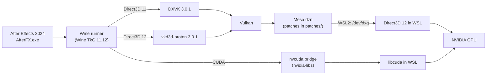

# NuxFX

> **Special thanks:** [@VulpesNoct1s](https://github.com/VulpesNoct1s) (Yakup ÜNAL).

Run Adobe After Effects 2024 on Linux. NuxFX holds the patches and scripts for a Wine
setup in which the GPU is reached through Mesa's Dozen (dzn) Vulkan driver, DXVK and
vkd3d-proton. CUDA goes through a bridge inside the Wine prefix.

NuxFX contains no Adobe software and no Wine runner. Bring your own licensed copy of
After Effects 2024.

> **Works:** After Effects 2024 (24.6.2) under WSL2, with the CUDA bridge and the Advanced 3D
> renderer, with Adobe's files unmodified. See the [status table](#status) and the
> [distributions that were tested](#supported-distributions).
> **Does not work:** the Cinema 4D renderer, and RAM preview is unreliable (see Gaps).

## Contents

- [Status](#status)
- [Supported distributions](#supported-distributions)
- [How it works](#how-it-works)
- [Installation](#installation)
- [Updating](#updating)
- [Configuration](#configuration)
- [Tests](#tests)
- [Repository layout](#repository-layout)
- [Documentation](#documentation)
- [Gaps](#gaps)
- [License](#license)

## Status

Features under WSL2. The installer and the tests were run on fresh images of every
distribution in [the table below](#supported-distributions):

| Feature | Status | Notes |
|---|---|---|
| Start and run After Effects 2024 (24.6.2) | Works | |
| Composition panel | Works | AE's OpenGL display draws it. `scripts/ae_prefs.sh` turns off AE's DirectX display (it cannot work with the CUDA bridge). Wine needs `libXcomposite`, or the panel stays black (see [Libraries that Wine opens at run time](#libraries-that-wine-opens-at-run-time)) |
| RAM preview (space) | Does not work reliably | The playhead stops after 1 to 3 seconds on the first preview, and later previews may not move. See [Gaps](#gaps) |
| Classic 3D renderer | Works | Panel and render queue |
| Direct3D 11 swapchain windows | Works | Patch 17 |
| Advanced 3D renderer (`ADBE Calder`) | Works (simple scene) | Needs the CUDA bridge, patches 19 and 20 and Adobe's `d3dcompiler_47.dll` (it is in the After Effects folder). `tests/run_ae_advanced3d_test.sh` renders a tilted 3D solid. See [Gaps](#gaps) |
| Cinema 4D renderer (`ADBE Ernst`) | Does not work | AE's plugin scan does not load the plugin under Wine |
| Effects on the GPU | Partly | Only Invert and solid layers were checked |
| CUDA | Works for AE | The project uses CUDA acceleration (`tests/run_ae_advanced3d_test.sh` checks it) and Advanced 3D needs it. Device queries work (patch 18). Direct3D interop is not implemented |
| GPUSniffer DirectX test | Passes | Result 529 |
| Vulkan conformance | Not tested | dzn is not a conformant Vulkan implementation |

The match name `ADBE Advanced 3d` is the classic renderer (Classic 3D). Advanced 3D is
`ADBE Calder`.

## Supported distributions

| Distribution | Environment | Status |
|---|---|---|
| Ubuntu 24.04 LTS | WSL2 | Works: `install.sh` on a fresh image, `doctor.sh` clean, all tests pass |
| Debian 13 | WSL2 | Works (same checks) |
| Fedora 44 | WSL2 | Works (same checks) |
| Arch Linux | WSL2 | Works (same checks) |
| openSUSE Tumbleweed | WSL2 | Works (same checks; Xvfb for the tests needs a workaround, see [known issues](docs/known-issues.md)) |
| Other Ubuntu and Debian releases, Linux Mint, Pop!_OS, Rocky, Alma, openSUSE Leap, Manjaro, EndeavourOS | WSL2 | Not verified (same package families as the rows above) |
| Any distribution | Native Linux | Not verified |

"Works" means: a fresh WSL2 image, `./install.sh --yes`, then `scripts/doctor.sh` with no
failure, then `tests/run_gl_window_test.sh`, `tests/run_ae_viewer_test.sh`,
`tests/run_ae_advanced3d_test.sh` (renderer `ADBE Calder`, CUDA acceleration) and
`tests/run_push_descriptor_test.sh` all pass. "Not verified" means the steps below are given
for that distribution, but nothing in this repository has been run on it. On native Linux
the host's own Vulkan driver is used. The dzn build (step 3) and the WSL2-only parts do not
apply there. Set `AEGNUX_VULKAN=system`.

## How it works



- **WSL2.** dzn implements Vulkan on top of Direct3D 12. The Direct3D 12 driver is reached
  through `/dev/dxg`. The patches in `patches/` apply to pristine Mesa 25.2.8.
  OpenGL (Wine draws After Effects' Composition panel with it, through EGL) goes through
  Mesa's D3D12 Gallium driver (`GALLIUM_DRIVER=d3d12`). `scripts/build_gl.sh` builds that
  driver and EGL from the same Mesa 25.2.8 source into their own prefix, and the scripts
  put it first in `LD_LIBRARY_PATH` for Wine. The distribution's own Mesa is not used,
  because it differs from distribution to distribution (with Mesa 26 on Arch Linux the
  panel stayed empty).
- **Native Linux.** The host's own Vulkan driver (RADV, ANV, NVIDIA) is used, and dzn is
  not built.

## Quick install

```sh
git clone https://github.com/chunsal/NuxFX.git
cd NuxFX
./install.sh
```

On Windows with WSL2, double-click `install.cmd` instead. The installer asks first, then
runs without further input:

1. **After Effects folder.** It lists the After Effects installs it finds on this PC
   (`C:\Program Files\Adobe\...\Support Files`) or lets you type or browse for one.
2. **Plugins and extensions.** It shows where plugins (`.aex`) and CEP extensions live in
   the Wine prefix and offers to import them from your Windows install or from any folder.
3. **Plan.** It shows every choice and asks once before it starts.

Then it installs the system packages (with `sudo`), the Wine runner, dzn and the OpenGL
driver (WSL2, both built from Mesa 25.2.8), the Wine prefix, DXVK, vkd3d-proton, the CUDA
bridge, your After Effects files, your plugins and a menu entry, and runs
`scripts/doctor.sh`. Downloads are checked by SHA-256. Finished parts
are skipped on a second run. Options: `./install.sh --help` (`--yes`, `--ae-dir`, `--plugins`,
`--extensions`, `--home`, `--dry-run`, `--force`).

The installer was run end to end (system packages, runner, dzn and OpenGL builds, prefix,
winetricks, DXVK, vkd3d-proton, CUDA bridge, After Effects files) on fresh WSL2 images of
the distributions in [the table above](#supported-distributions). `install.cmd` and the
plugin and extension import were not run through the fresh-image checks.

You bring the After Effects files yourself. The installer does not download Adobe software
and does not touch Adobe's licensing. The manual steps below are what the installer does.

## Installation

The steps are the same on every distribution. Only the package names in step 2 change.
Steps marked *WSL2* apply only to WSL2 on Windows.

### 1. Windows and WSL2

*WSL2 only.*

1. Install the current NVIDIA driver for Windows. NVIDIA recommends driver 580 or newer
   for CUDA and OptiX under WSL.
2. In an administrator PowerShell, install Ubuntu 24.04:
   `wsl --install -d Ubuntu-24.04`. Restart if asked.
3. Inside WSL, check the GPU paths and the driver:

   ```sh
   ls /dev/dxg /usr/lib/wsl/lib/libd3d12.so /usr/lib/wsl/lib/libcuda.so.1
   nvidia-smi
   ```

### 2. System packages

Install the packages for your distribution. They cover the dzn build (step 3), the Wine
helper tools (steps 4 to 7) and the tests.

**Ubuntu 24.04, Debian, Linux Mint, Pop!_OS**

```sh
sudo apt update
sudo apt install build-essential git pkg-config ninja-build python3-mako pipx \
    curl xz-utils zstd cabextract winetricks gcc-mingw-w64-x86-64 libx11-dev \
    x11-utils xdotool xvfb libgl1-mesa-dri
pipx ensurepath
pipx install meson
```

Open a new shell after `pipx ensurepath`. Ubuntu 24.04 ships meson 1.3, which is too old
for Mesa 25.2.8 (it needs meson 1.4 or newer), so meson comes from pipx here. Check with
`meson --version`. `libgl1-mesa-dri` provides the D3D12 OpenGL driver under WSL2.

**Fedora**

```sh
sudo dnf install gcc gcc-c++ git pkgconf-pkg-config ninja-build python3-mako pipx \
    curl xz zstd cabextract winetricks mingw64-gcc libX11-devel xdotool xwininfo \
    xorg-x11-server-Xvfb
pipx ensurepath
pipx install meson
```

Under WSL2 also install the Mesa OpenGL driver package of your distribution, which
provides the D3D12 OpenGL driver.

**Arch Linux, Manjaro, EndeavourOS**

```sh
sudo pacman -S --needed base-devel git pkgconf ninja meson python-mako curl xz zstd \
    cabextract winetricks mingw-w64-gcc libx11 xdotool xorg-xwininfo xorg-server-xvfb
```

Check `meson --version` (1.4 or newer).

**openSUSE**

```sh
sudo zypper install -t pattern devel_basis
sudo zypper install git pkgconf ninja meson python3-Mako curl xz zstd cabextract \
    winetricks mingw64-cross-gcc libX11-devel xdotool xwininfo xorg-x11-server-Xvfb
```

Check `meson --version` (1.4 or newer).

#### Libraries that Wine opens at run time

Wine loads these with `dlopen`, so a package manager does not pull them in for a runner
that is not a distribution package, and Wine does not complain when one is missing: it
switches the feature off. A missing `libXcomposite` leaves After Effects' Composition
panel black although the frames render. `install.sh` installs them, `scripts/doctor.sh`
lists the missing ones with the install command for your distribution, and
`tests/run_gl_window_test.sh` checks the effect.

```sh
# Ubuntu, Debian
sudo apt install libx11-6 libxext6 libxi6 libxrandr2 libxrender1 libxfixes3 libxcursor1 \
    libxcomposite1 libxinerama1 libxxf86vm1 libxkbcommon0 libxkbregistry0 libfreetype6 \
    libfontconfig1 libgnutls30 libegl1 libgl1
# Fedora
sudo dnf install libX11 libXext libXi libXrandr libXrender libXfixes libXcursor libXcomposite \
    libXinerama libXxf86vm libxkbcommon freetype fontconfig gnutls libglvnd-egl libglvnd-glx
# Arch Linux
sudo pacman -S --needed libx11 libxext libxi libxrandr libxrender libxfixes libxcursor \
    libxcomposite libxinerama libxxf86vm libxkbcommon freetype2 fontconfig gnutls libglvnd
# openSUSE
sudo zypper install libX11-6 libXext6 libXi6 libXrandr2 libXrender1 libXfixes3 libXcursor1 \
    libXcomposite1 libXinerama1 libXxf86vm1 libxkbcommon0 libxkbregistry0 libfreetype6 \
    libfontconfig1 libgnutls30 libEGL1 libGL1
```

**Libraries for the dzn build (WSL2 only)**

Mesa 25.2.8 needs more development packages than the lists above. The Debian/Ubuntu names
below were checked against a Mesa configure log; the names for other distributions are
printed by `scripts/doctor.sh --build` and are best guesses.

```sh
sudo apt install bison flex glslang-tools python3-yaml python3-packaging libdrm-dev \
    libexpat1-dev zlib1g-dev libelf-dev libzstd-dev libwayland-dev wayland-protocols \
    libx11-xcb-dev libxcb1-dev libxcb-dri3-dev libxcb-present-dev libxcb-randr0-dev \
    libxcb-shm0-dev libxcb-sync-dev libxcb-xfixes0-dev libxcb-keysyms1-dev libxrandr-dev \
    libxshmfence-dev spirv-tools
```

`scripts/doctor.sh --build` and `build_dzn.sh` list what is still missing, including a
meson older than 1.4.

### 3. Mesa and dzn

*WSL2 only.*

```sh
cd ~
curl -LO https://archive.mesa3d.org/mesa-25.2.8.tar.xz
git clone https://github.com/chunsal/NuxFX.git
cd NuxFX
MESA_TARBALL="$HOME/mesa-25.2.8.tar.xz" scripts/build_dzn.sh
scripts/build_gl.sh
```

`build_dzn.sh` checks the tarball's SHA-256, applies the patches, builds
`libvulkan_dzn.so` and installs it under `$DZN_PREFIX` (default `$AEGNUX_HOME/dzn`).
It writes the install locations to `~/.config/aegnux/aegnux.conf`. Meson downloads
DirectX-Headers from GitHub during configure. Set `https_proxy` if you need a proxy.

`build_gl.sh` builds Mesa's EGL library and its Direct3D 12 OpenGL driver from the same
source tree and installs them under `$AEGNUX_GL_PREFIX` (default `$AEGNUX_HOME/mesa-gl`).
`aegnux_env` puts that folder first in `LD_LIBRARY_PATH`, so Wine's OpenGL does not depend on
the distribution's Mesa. `AEGNUX_SYSTEM_GL=1` uses the distribution's OpenGL instead.

### 4. Wine runner

The runner used for the working setup is **Wine TkG (staging) 11.12**. NTsync is not used: `/dev/ntsync` does not exist on the WSL2 kernel used for testing, and `doctor.sh` reports it. Build it
with the non-makepkg script of [wine-tkg-git](https://github.com/Frogging-Family/wine-tkg-git).
Dependencies are listed in its [wiki](https://github.com/Tk-Glitch/PKGBUILDS/wiki/wine-tkg-git).

```sh
git clone https://github.com/Frogging-Family/wine-tkg-git.git
cd wine-tkg-git/wine-tkg-git
./non-makepkg-build.sh --deps64     # lists missing build dependencies
./non-makepkg-build.sh
```

The build is written to the `non-makepkg-builds` directory. Install it so that
`$AEGNUX_HOME/runner/bin` contains `wine` and `wineserver`. Set `WINE_BIN_DIR` if you put
it elsewhere.

### 5. Wine prefix

```sh
cd ~/NuxFX
. scripts/common.sh && aegnux_env     # runner on PATH, prefix location, AE's overrides
wineboot -i                           # create the prefix
wine reg add 'HKCU\Software\Wine' /v Version /d win10 /f
winetricks -q vcrun2022 d3dcompiler_47
# winetricks installs the 2013 d3dcompiler_47 (6.3.9600). Advanced 3D needs Adobe's newer
# one, which is part of the AE install:
cp "$AE_DIR/CEPHtmlEngine/d3dcompiler_47.dll" "$WINEPREFIX/drive_c/windows/system32/d3dcompiler_47.dll"
```

`aegnux_env` puts the runner on `PATH` and sets `WINEPREFIX` to `$AEGNUX_HOME/wineprefix`
(default `~/.local/share/aegnux/wineprefix`). Keep that shell open for steps 6 and 7.

### 6. DXVK and vkd3d-proton

Direct3D 11 is translated by DXVK 3.0.1. Direct3D 12 is translated by vkd3d-proton 3.0.1.
Download the release archives:

- DXVK 3.0.1: <https://github.com/doitsujin/dxvk/releases/tag/v3.0.1> (`dxvk-3.0.1.tar.gz`)
- vkd3d-proton 3.0.1: <https://github.com/HansKristian-Work/vkd3d-proton/releases/tag/v3.0.1> (`vkd3d-proton-3.0.1.tar.zst`)

DXVK has no install script in its 3.0.1 archive, so copy the DLLs and set the overrides:

```sh
cd ~
tar -xzf dxvk-3.0.1.tar.gz
cp dxvk-3.0.1/x64/{d3d9,d3d10core,d3d11,dxgi}.dll "$WINEPREFIX/drive_c/windows/system32/"
cp dxvk-3.0.1/x32/{d3d9,d3d10core,d3d11,dxgi}.dll "$WINEPREFIX/drive_c/windows/syswow64/"
for dll in d3d9 d3d10core d3d11 dxgi; do
    wine reg add 'HKCU\Software\Wine\DllOverrides' /v "$dll" /d "native,builtin" /f
done
```

vkd3d-proton ships an install script, which copies its DLLs and sets the overrides:

```sh
tar --zstd -xf vkd3d-proton-3.0.1.tar.zst
cd vkd3d-proton-3.0.1
./setup_vkd3d_proton.sh install
cd ~
```

### 7. CUDA bridge

*WSL2 with an NVIDIA GPU.* After Effects reaches CUDA through the `nvcuda.dll` of
[nvidia-libs](https://github.com/SveSop/nvidia-libs). Download the release
(`nvidia-libs-v1.0.2.tar.xz`, <https://github.com/SveSop/nvidia-libs/releases/tag/v1.0.2>):

```sh
mkdir -p "$WINEPREFIX/nvidia-libs"
tar -xJf ~/nvidia-libs-v1.0.2.tar.xz -C "$WINEPREFIX/nvidia-libs"
"$WINEPREFIX/nvidia-libs/nvidia-libs-v1.0.2/setup_nvlibs.sh" install
```

The installer links the DLLs from that folder into the prefix, so keep the folder.

### 8. After Effects

Copy the contents of the `Support Files` folder of your After Effects 2024 (24.6.2)
installation to `$AEGNUX_HOME/AE`. The folder must contain `AfterFX.exe`, `AMT/` and
`Required/`. Use a copy you are licensed to use. On Windows the folder is
`C:\Program Files\Adobe\Adobe After Effects 2024\Support Files`. Under WSL2:

```sh
mkdir -p "$HOME/.local/share/aegnux/AE"
cp -r "/mnt/c/Program Files/Adobe/Adobe After Effects 2024/Support Files/." "$HOME/.local/share/aegnux/AE/"
```

### 9. Check and start

```sh
cd ~/NuxFX
scripts/doctor.sh          # read-only: reports missing parts and the DLL versions
scripts/launch_ae.sh       # start After Effects; logs go to $AEGNUX_LOG_DIR/ae_<timestamp>/
scripts/stop_ae.sh
```

`doctor.sh` ends with the number of failures and warnings. A "untested build" warning
means a DLL differs from the versions in steps 6 and 7.

`launch_ae.sh` clears the previous-crash state, so the Crash Repair dialog does not block
startup. It applies `ae_prefs.sh` before every start, and it checks that the dzn ICD and
`AfterFX.exe` exist. `scripts/launch_ae.sh 150` stops AE after 150 seconds.

### Preferences set by ae_prefs.sh

The script applies these to every After Effects preferences folder in the prefix and to
the folder of the installed version, read from `AMT/application.xml`.

| Setting | Why | Opt out |
|---|---|---|
| `DS.DisableDirectXDisplay = true` (Debug Database) | With CUDA available, AE shows Composition panel frames through its DirectX display, which passes images between CUDA and Direct3D 12. The CUDA bridge cannot share those resources, so the panel stayed empty. | `AEGNUX_DIRECTX_DISPLAY=1` |
| `"Show Welcome Screen" = 00` (Prefs) | The HTML Home screen renders as an empty panel that covers the workspace. | `AEGNUX_HIDE_HOME_SCREEN=0` |

## Updating

Update the repository with `git pull`, then run `scripts/build_dzn.sh` again. The build
records the patches it has applied in `.aegnux-patches-applied` in the Mesa tree, and it
applies only the patches that are missing. A tree built before that record existed is
detected from the patches that reverse cleanly.

The build lives in its own prefix, so the distribution's Mesa is not changed. DXVK,
vkd3d-proton and nvidia-libs are not updated by this repository. `doctor.sh` reports DLLs
that differ from the versions above.

## Configuration

Each setting comes from the environment. If it is not set there, it comes from
`~/.config/aegnux/aegnux.conf` (plain `KEY=value` lines; `AEGNUX_CONFIG` points elsewhere).
If it is not there either, the default in `scripts/common.sh` is used.

| Variable | Default | Meaning |
|---|---|---|
| `AEGNUX_HOME` | `~/.local/share/aegnux` | Data folder |
| `WINE_BIN_DIR` | `$AEGNUX_HOME/runner/bin` | Wine runner |
| `WINEPREFIX` | `$AEGNUX_HOME/wineprefix` | Wine prefix |
| `AE_DIR` | `$AEGNUX_HOME/AE` | Folder that contains `AfterFX.exe` |
| `DZN_PREFIX` | `$AEGNUX_HOME/dzn` | dzn install, written by `build_dzn.sh` |
| `AEGNUX_VULKAN` | `auto` | `dzn`, `system` or `auto` |
| `AEGNUX_GL_PREFIX` | `$AEGNUX_HOME/mesa-gl` | Install of `scripts/build_gl.sh` (Mesa's EGL and d3d12 OpenGL driver). When it exists, Wine uses it under WSL2 |
| `AEGNUX_SYSTEM_GL` | `0` | `1` uses the distribution's OpenGL even when `AEGNUX_GL_PREFIX` exists |
| `AEGNUX_DISABLE_CUDA` | `0` | `1` turns CUDA off for AE (nvcuda and nvcuvid are disabled) and sets `DZN_DEBUG=nocudauuid`, so dzn does not query CUDA. AE then renders in software and reports Advanced 3D as unsupported |
| `AEGNUX_DIRECTX_DISPLAY` | `0` | `1` keeps AE's DirectX display (the panel stays empty while CUDA is used) |
| `AEGNUX_HIDE_HOME_SCREEN` | `1` | `0` keeps AE's Home screen setting. On a first start, when AE has no preferences file yet, `ae_prefs.sh` writes one with the Home screen off (it renders as an empty panel over the whole workspace) |
| `AEGNUX_COACHMARKS` | `1` | `0` switches off AE's first-start tips (the tests use it) |
| `AEGNUX_EXTRA_OVERRIDES` | empty | Extra `WINEDLLOVERRIDES` entries |
| `AEGNUX_WINEDEBUG` | errors only | `WINEDEBUG` for AE |
| `AEGNUX_APIVER_LAYER` | `0` | `1` enables the optional apiVersion layer. Not needed with patch 04 |

## Tests

```sh
tests/run_gl_window_test.sh        # an OpenGL child window reaches the screen (Wine's libraries; no AE needed)
tests/run_dxgi_present_test.sh     # D3D11 swapchain shows its backbuffer (patch 17)
tests/run_ae_viewer_test.sh        # Composition panel shows a rendered comp
tests/run_ae_advanced3d_test.sh    # Advanced 3D renders a tilted 3D solid (needs the CUDA bridge)
tests/run_push_descriptor_test.sh  # dzn push descriptors reach a compute shader (patch 20)
scripts/gpu_sniffer_test.sh        # dzn entrypoint audit, then AE's GPUSniffer DirectX test
```

- `run_gl_window_test.sh` needs `x86_64-w64-mingw32-gcc`, Xvfb, xwininfo, python3 and gcc
  with X11 headers. A small Windows program opens a window with an OpenGL child window
  (the way AE draws the Composition panel) and the test looks for its cyan fill in a
  screenshot of a private Xvfb display. It fails, and names the missing library, when Wine
  cannot show the child window. It runs in about 15 seconds.
- `run_dxgi_present_test.sh` needs `x86_64-w64-mingw32-gcc` (`gcc-mingw-w64-x86-64`), gcc
  with X11 headers (`libx11-dev`), xdotool and python3.
- `run_ae_viewer_test.sh` needs xdotool, xwininfo (`x11-utils`), python3 and gcc with X11
  headers. It starts AE with a temporary startup script that creates a comp with a red
  solid and an Invert effect. The test passes if the Composition panel shows cyan. With
  Xvfb installed it runs on a private display, so nothing appears on your desktop. It
  stops any AE of the prefix that is running.
- `run_ae_advanced3d_test.sh` has the same requirements. Its startup script selects the
  Advanced 3D renderer for a comp with a tilted red 3D solid and saves frame 0 as a PNG; the
  test passes if AE keeps the renderer and the PNG shows red and no magenta. Scripts may not
  write files unless the AE preference allows it, so the result is carried in the name of the
  comp of a project the script saves.
- `run_push_descriptor_test.sh` needs cc, the Vulkan headers and loader (`libvulkan-dev`),
  `glslangValidator` and the dzn build.
- `gpu_sniffer_test.sh` needs the dzn build and the After Effects files.

## Repository layout

```
patches/   20 patches (git format-patch) against pristine Mesa 25.2.8
scripts/   build_dzn.sh          build and install dzn (WSL2)
           build_gl.sh           build and install Mesa's EGL and d3d12 OpenGL driver (WSL2)
           launch_ae.sh          start AE (applies ae_prefs.sh and clear_crash_state.sh)
           stop_ae.sh            stop AE and its wineserver
           doctor.sh             read-only check of host, prefix, AE and tools
           ae_prefs.sh           AE preferences this setup needs
           clear_crash_state.sh  clears AE's previous-crash state
           common.sh             shared settings, platform detection, config file
           gpu_sniffer_test.sh   entrypoint audit, then GPUSniffer
           dzn_audit.c, gen_cmds.py   entrypoint audit of dzn
           apiver_layer/        optional Vulkan layer (apiVersion), off by default
           tools/xcap.c         X11 screen capture for the tests
tests/     run_gl_window_test.sh, run_dxgi_present_test.sh, run_ae_viewer_test.sh,
           run_ae_advanced3d_test.sh, run_push_descriptor_test.sh, gl_window_test.c,
           dxgi_present_test.c, push_descriptor_test.c, push_descriptor.comp
docs/      technical-note.md    findings and evidence, section by section
           known-issues.md      fixed and open issues, stubs, limitations
LICENSE    GPL-3.0-or-later
NOTICE     third-party notices (Mesa and dzn, MIT)
```

## Documentation

- [`docs/technical-note.md`](docs/technical-note.md): how each problem was narrowed down,
  with the evidence.
- [`docs/known-issues.md`](docs/known-issues.md): fixed issues, open issues, stubs and
  limitations.

## Gaps

What is missing, broken or not decided yet.

**Not working**

- Advanced 3D renderer (`ADBE Calder`): renders a 3D solid correctly (patch 19, Adobe's d3dcompiler_47, empty the disk cache once). A solid that faces the camera keeps its colour; a tilted one is darker than in the Classic 3D renderer (the Advanced 3D default light; no reference render from Windows was compared). Lights, shadows, models and environment textures were not tested. `docs/known-issues.md` has the causes.
- Cinema 4D renderer (`ADBE Ernst`): not tested (the plugin-scan message that was blamed earlier for Advanced 3D is harmless).
- RAM preview: the playhead stops after 1 to 3 seconds of the first preview, and later previews may not move. The cause is not known. `docs/known-issues.md` has the evidence and the tests that did not change it.
- `tests/run_ae_viewer_test.sh` checks one frame (a red solid with Invert). It does not play the comp.

**Not verified**

- Distributions that are not in the table above, and native Linux hosts.
- NVIDIA's own Vulkan driver, AMD and Intel GPUs. Everything was run on one NVIDIA GPU.
- After Effects versions other than 24.6.2.
- Effects other than Invert and solid layers, and large projects.
- The manual steps in [Installation](#installation) are what `install.sh` does; the
  installer is what was run from scratch.

**dzn**

- `VK_EXT_transform_feedback` is a no-op stub (patch 09). Stream output is dropped.
- Patch 15 advertises 24 features and extensions in one file. None of them has been tested
  one by one. The README says DXVK 3.0.1 needs `inlineUniformBlock` and `nullDescriptor`;
  that was not checked again. Each flag needs a test before it stays advertised. The list
  is in `docs/known-issues.md`.
- There are no sparse resources, so vkd3d-proton stops at Direct3D 12 feature level 11_1.
- The robustness features are advertised without a dedicated test.
- No Vulkan CTS run. dzn prints "not a conformant Vulkan implementation".

**CUDA bridge**

- Direct3D interop: `cuGraphicsD3D11RegisterResource` returns `CUDA_ERROR_NOT_SUPPORTED`.
  Features that share images between CUDA and Direct3D do not work.

**Packaging**

- The Wine runner, DXVK, vkd3d-proton, nvidia-libs and the AE files are installed by hand
  (steps 4 to 8). `doctor.sh` checks them, but the repository does not download or pin them.
- No CI. The tests need Xvfb (they run on a private display) and a Windows After Effects
  folder for the AE tests.
- The code and the configuration keep the `aegnux` name (`AEGNUX_*` variables,
  `~/.local/share/aegnux`, `aegnux.conf`).

## License

NuxFX is free software under the GNU General Public License, version 3 or later
(GPL-3.0-or-later). See [LICENSE](LICENSE). Any distributed modified version must also be
released as free software under the same license.

- Third-party notices: [NOTICE](NOTICE). Mesa and its dzn driver are MIT-licensed, and the
  MIT notice is reproduced there.
- Contributions: [CONTRIBUTING.md](CONTRIBUTING.md).

Adobe and After Effects are trademarks of Adobe. NuxFX is not affiliated with Adobe.
Running After Effects requires your own license from Adobe.
