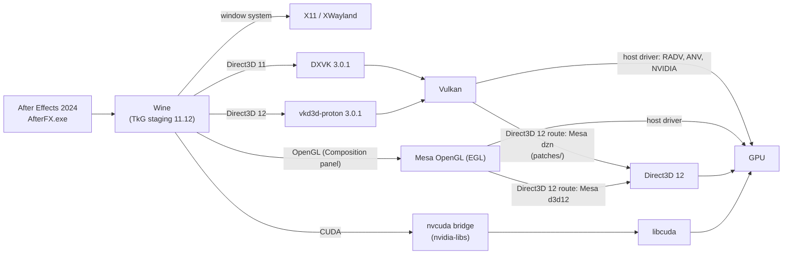

# How NuxFX works

- **Wine** (TkG staging 11.12, a prebuilt runner by Kron4ek, checked by SHA-256) runs
  `AfterFX.exe`. The Wine prefix gets DXVK 3.0.1 for Direct3D 11, vkd3d-proton 3.0.1 for
  Direct3D 12, nvidia-libs 1.0.2 (`nvcuda.dll`) for CUDA, the Visual C++ runtime and Adobe's own
  `d3dcompiler_47.dll`.
- **Display.** Wine's X11 driver, which is XWayland on a Wayland desktop ([wayland.md](wayland.md)).
- **GPU route, host drivers.** The system has a native GPU driver. Vulkan, OpenGL and CUDA come
  from the host (`AEGNUX_VULKAN=system`); the installer skips dzn and the Mesa packages. This route is
  written but has not been run on bare hardware yet.
- **GPU route, Direct3D 12.** The GPU is reachable only through Direct3D 12 (`/dev/dxg`).
  [Mesa's Dozen driver](https://docs.mesa3d.org/drivers/dozen.html) provides Vulkan. The 26
  patches in `patches/` apply to pristine Mesa 25.2.8 and make it good enough for DXVK,
  vkd3d-proton and After Effects. Wine's OpenGL (the Composition panel) uses Mesa's Direct3D 12
  OpenGL driver and EGL from the same Mesa source, in their own folder; the scripts put it first
  in `LD_LIBRARY_PATH`, so it does not depend on the Mesa of the distribution (Mesa 26 left the
  panel empty). All five verification runs took this route.
  Nothing is compiled on your machine: dzn and the OpenGL driver are built from those patches
  once, on Ubuntu 24.04, and attached to a release of this project as two small packages
  (`prebuilt/manifest.txt` has their SHA-256 and the hash of the patch series). `install.sh`
  downloads them with `scripts/fetch_prebuilt.sh`, and builds from source with `build_dzn.sh` and
  `build_gl.sh` only when no package fits the system.
- **Audio.** After Effects plays through winmm, Wine's PulseAudio driver and the machine's sound
  server (PulseAudio, or PipeWire's PulseAudio server). RAM preview needs that path to work or to be
  absent. The sound server of the Direct3D 12 route suspends its output when idle and does not resume
  the stream that After Effects opened at its start, which breaks RAM preview after the first stop,
  so `launch_ae.sh` plays a silent stream next to After Effects (`scripts/sound_keepalive.sh`;
  [troubleshooting.md](troubleshooting.md) has the details). `AEGNUX_AUDIO_DEVICES=0` turns After Effects'
  audio devices off instead.
- **The scripts** keep the setup stable: they install the libraries Wine opens at run time, pick
  the Wine display driver, set the After Effects preferences, clear crash state, keep the sound
  output awake, and check everything (`doctor.sh`).

More: [known-issues.md](known-issues.md) (what is open),
[technical-note.md](technical-note.md) (how each problem was narrowed down),
[manual-installation.md](manual-installation.md) (the installer's steps by hand).
